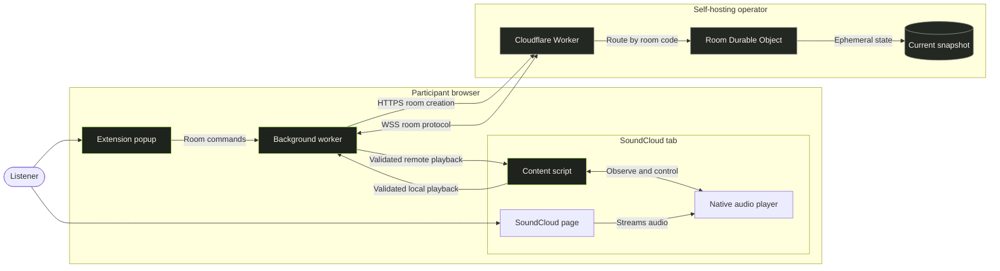

# SoundCloud Listen Along

An unofficial browser extension for synchronized listening through your own room server.

`MVP IMPLEMENTED` | `SELF-HOSTED ONLY` | `NO CENTRAL SERVICE`

[](https://github.com/vladi245/soundcloud-listen-along)
[](#browser-installation)
[](#firefox)
[](LICENSE)

> [!WARNING]
> This is an early MVP, not a production-ready service. Player integration can break when SoundCloud changes its page, and browser autoplay rules may require a guest to start playback once.

## Features

- Creates private, unlisted rooms on an operator-deployed Cloudflare Worker.
- Synchronizes the host's track URL, play/pause state, position, and seeks to guests.
- Shows host or guest role, participant count, connection state, and a shareable 16-character room code.
- Reconnects interrupted extension sessions and uses heartbeat timing to estimate server clock offset.
- Keeps backend selection and room credentials in browser session storage rather than persistent extension storage.
- Relays synchronization metadata only; audio remains on SoundCloud.
- Includes protocol validation, message-size and room-capacity limits, host authority, and automatic room cleanup.

Current limitations include one host per room, up to 25 WebSocket connections, no room password beyond possession of the room code, no room discovery, and no project-operated backend.

## Installation

Requirements: Node.js 22 or newer and npm.

```sh
git clone https://github.com/vladi245/soundcloud-listen-along.git
cd soundcloud-listen-along
npm ci
npm run check
npm run build
```

The Chromium build is written to `.output/chrome-mv3/`. Other available commands are `npm run dev`, `npm run dev:firefox`, `npm run build:firefox`, `npm run zip`, and `npm run zip:firefox`.

## Browser installation

### Chromium

1. Open `chrome://extensions` in Chrome, Chromium, or Brave, or `edge://extensions` in Edge.
2. Enable **Developer mode**.
3. Select **Load unpacked** and choose `.output/chrome-mv3/`.
4. Rebuild and reload the extension after pulling changes; unpacked extensions do not update automatically.

### Firefox

Run `npm run build:firefox`, open `about:debugging#/runtime/this-firefox`, select **Load Temporary Add-on**, and choose `.output/firefox-mv3/manifest.json`. This temporary development installation is removed when Firefox closes. There is no signed Firefox build currently available.

## Self-hosting

The room server is a Cloudflare Worker backed by one Durable Object per room. Deploy it under your own Cloudflare account by following [the deployment guide](docs/deployment.md). The project does not provide a central room service, discovery service, analytics endpoint, or fallback relay.

After deployment:

1. Open the extension popup and enter the exact Worker origin printed by Wrangler, for example `https://soundcloud-listen-along-server.example.workers.dev`. Hosts also enter the operator's room creation key.
2. Grant the requested optional permission for that origin.
3. Open a SoundCloud track and accept the transmission notice.
4. Create a room and share its code, or join a code from another participant using the same backend origin.

Use HTTPS for deployed backends. HTTP is accepted only for `localhost` and `127.0.0.1` development origins.

## Architecture



The content script observes SoundCloud's audio element and applies guest playback changes. The background worker owns session state, backend access, WebSocket reconnection, and protocol validation. The Worker creates rooms and routes each room to a Durable Object, which validates participants, grants control only to the host token holder, stores the latest playback snapshot, and broadcasts room state.

See [architecture](docs/architecture.md), [privacy](docs/privacy.md), and [compliance notes](docs/compliance.md).

## Contributing and security

- Read the [contributing guide](CONTRIBUTING.md) and [Code of Conduct](CODE_OF_CONDUCT.md).
- Use [issues](https://github.com/vladi245/soundcloud-listen-along/issues) for bugs and scoped proposals.
- Report vulnerabilities through the private process in [SECURITY.md](SECURITY.md).

## License and notice

Released under the [MIT License](LICENSE).

This independent project is not affiliated with, authorized by, sponsored by, or endorsed by SoundCloud or its affiliates. "SoundCloud" is used only to describe compatibility. SoundCloud and related marks belong to their respective owners.
