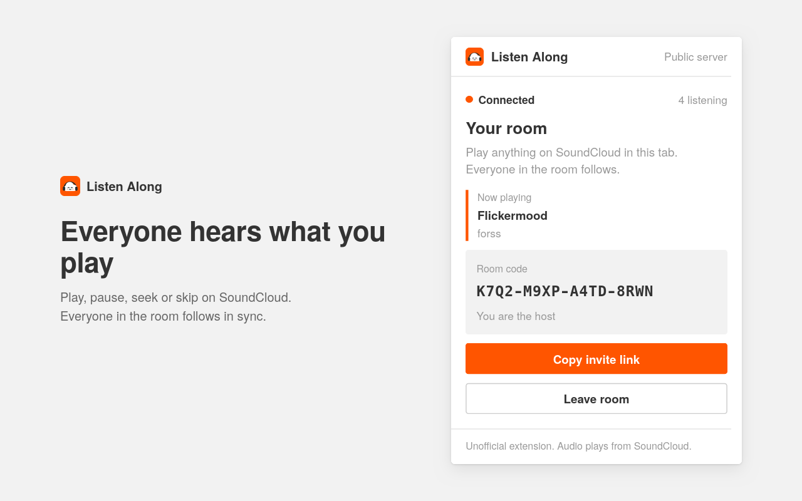

<p align="center">
  
</p>

<h1 align="center">Listen Along</h1>

<p align="center">
  Listen to SoundCloud together. Start a room from any track, share the link,<br>
  and everyone hears what you play, in sync.
</p>

<p align="center">
  <a href="https://soundcloud-listen-along.vladi245.workers.dev"><b>Install</b></a> ·
  <a href="#how-it-works">How it works</a> ·
  <a href="#privacy">Privacy</a> ·
  <a href="docs/deployment.md">Self-hosting</a>
</p>

<p align="center">
  
</p>

## How it works

1. **Host:** open a track on SoundCloud, click the extension and select **Start a room**. The invite link is copied for you.
2. **Friends:** open the link and select **Join room**. SoundCloud opens and plays along with you.
3. Play, pause, seek or skip as usual. Everyone in the room follows.

No accounts and no setup. Audio always streams from SoundCloud in each listener's own browser; the extension only keeps playback in step.

## Install

Open the [install page](https://soundcloud-listen-along.vladi245.workers.dev) in your browser:

- **Firefox:** select **Install for Firefox**. Updates install automatically.
- **Chrome, Edge, Brave:** follow the load-unpacked steps on the page.

## Privacy

While you are in a room, the extension shares only the current track link and playback position with the room server. Rooms are private, unlisted and deleted when they end. There are no accounts, ads, analytics or tracking. See the [privacy policy](https://soundcloud-listen-along.vladi245.workers.dev/privacy) and [privacy notes](docs/privacy.md).

## Development

Requires Node.js 22 or newer.

```sh
npm ci
npm run dev          # Chromium with live reload (dev:firefox for Firefox)
npm run check        # format, lint, types and tests
npm run build:all    # production builds in .output/
```

The room server is a Cloudflare Worker with one Durable Object per room. Run it locally with `npm --prefix server run dev`, deploy your own with the [deployment guide](docs/deployment.md), and release with `npm run release:hosted`. See also the [architecture](docs/architecture.md).

## License

[MIT](LICENSE). Listen Along is an independent project and is not affiliated with, authorized by, sponsored by or endorsed by SoundCloud. "SoundCloud" is used only to describe compatibility.
